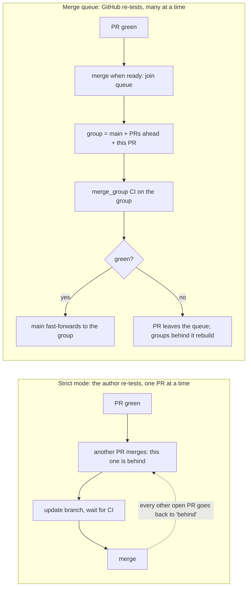

# merge-queue-lab

**GitHub merge queue vs "require branches to be up to date", tested on a live
repository, with dependency bots, signed commits and pull-request-shaped checks.**

Many teams protect `main` with *strict* required checks: a pull request may
merge only if it contains the latest `main`. That's safe, but it turns every
merge into a serial update, wait and merge loop. GitHub's **merge queue**
promises the same safety without the loop. This repository tests that promise,
especially in the places where real setups differ from the demo:

- **Bots.** A dependency bot (Renovate) merges its own PRs, and a workflow
  approves them. Other bots open PRs with `GITHUB_TOKEN`.
- **Signed commits on every branch.** The queue creates its own temporary
  branches. Does a "signatures required on `~ALL`" ruleset get in the way?
- **Pull-request-shaped checks.** A "changelog fragment" check reads the PR's
  base and head. Inside a merge queue there is no pull request.
- **Bypass and direct merges.** What admins, scripts and the REST API can still
  do on a branch that requires a queue.

Each scenario links to its pull requests and workflow runs, so you can check the
evidence rather than take it on trust.

> Status: round 1 (S0–S11, B1–B5) ran on 2026-10-21 and round 2 (S12–S32,
> B6–B10) on 2026-11-07 and 2026-11-09, against this repository. Each result links to its
> write-up in [docs/scenarios.md](docs/scenarios.md), which links to the pull
> requests and runs. Raw numbers are in [docs/results/](docs/results/). Round 2
> corrects two round 1 claims; see S30.

## Results at a glance

| ID | Question | Result | Evidence |
| --- | --- | --- | --- |
| S0 | Without strict mode or a queue, can two green PRs break `main`? | Yes. `main` was broken for almost 7 minutes, until a fix-forward PR landed | [scenarios.md#s0](docs/scenarios.md#s0) |
| S1 | Strict mode: what does landing 4 independent PRs cost? | **7.6 min**, 7 CI runs, 3 "Update branch" round trips | [scenarios.md#s1](docs/scenarios.md#s1) |
| S2 | Merge queue: the same 4 PRs | **2.7 min**, 8 CI runs, no branch updates: 2.8× faster for one extra run | [scenarios.md#s2](docs/scenarios.md#s2) |
| S3 | Does the queue catch a semantic conflict? | Yes. The pair failed together in the queue; `main` stayed green | [scenarios.md#s3](docs/scenarios.md#s3) |
| S4 | A required check whose workflow lacks `merge_group` | The PR looks green, then is removed at the check timeout | [scenarios.md#s4](docs/scenarios.md#s4) |
| S5 | Signed commits required on every branch, plus a queue | No conflict. The tested group commit *is* the commit on `main`, signed by GitHub | [scenarios.md#s5](docs/scenarios.md#s5) |
| S6 | A pull-request-shaped check inside a merge group | The naive version fails in every group, so its PR is ejected in under a minute; a job-level skip passes | [scenarios.md#s6](docs/scenarios.md#s6) |
| S7 | Direct merges and bypass on a queue branch | REST merge: HTTP 405. Async `direct_merge` / `bypass_rules`: "pending", then nothing | [scenarios.md#s7](docs/scenarios.md#s7) |
| S8 | Strict mode *and* a queue together | Free: a PR behind `main` is queued and merged without an update | [scenarios.md#s8](docs/scenarios.md#s8) |
| S9 | The queue ruleset is deleted and recreated while PRs wait | Queued PRs are **stranded**: never merged or removed until enqueued again | [scenarios.md#s9](docs/scenarios.md#s9) |
| S10 | "Restrict who can push" on top of a queue | **Blocks every queue merge** (`branch_protection_failure`), even for an explicitly allowed enqueuer | [scenarios.md#s10](docs/scenarios.md#s10) |
| S11 | Enqueue through the async API before the PR's checks pass | The request is dropped silently; use auto-merge instead | [scenarios.md#s11](docs/scenarios.md#s11) |
| S12 | Terraform changes the queue ruleset | `plan`: parameter changes, renames, even a new target are **in-place updates**; renaming the resource address without `moved` is destroy + create. `apply` not run | [scenarios.md#s12](docs/scenarios.md#s12) |
| S13 | An organization ruleset plus the repo's queue | Skipped: no organization access from the lab driver | [scenarios.md#s13](docs/scenarios.md#s13) |
| S14 | Two queues on one branch | Skipped: needs a click in the web UI | [scenarios.md#s14](docs/scenarios.md#s14) |
| S15 | Dequeue an entry in the middle | The PR behind is rebuilt within 16 s; the superseded runs are not cancelled (4 queue runs for 2 merges) | [scenarios.md#s15](docs/scenarios.md#s15) |
| S16 | Jump to the front | Everything behind rebuilds, as documented. A `GITHUB_TOKEN` jump gets no CI and **stalls the whole queue** until the timeout (19 min to land 3 PRs) | [scenarios.md#s16](docs/scenarios.md#s16) |
| S17 | Push a new commit to a queued PR | **Refused** (GH006, or HTTP 409 through the API): queued branches are locked | [scenarios.md#s17](docs/scenarios.md#s17) |
| S18 | Close a queued PR; delete its branch | Both remove it (`manual`) and rebuild the groups behind; deleting the branch is allowed despite the lock | [scenarios.md#s18](docs/scenarios.md#s18) |
| S19 | Request changes or dismiss the approval after enqueue | Both PRs **merged**: reviews are checked only at entry | [scenarios.md#s19](docs/scenarios.md#s19) |
| S20 | Draft PRs | Every path refuses (HTTP 400 "Pull request is in draft.") | [scenarios.md#s20](docs/scenarios.md#s20) |
| S21 | Unresolved conversation added after enqueue | **Merged**; a thread before enqueue is refused | [scenarios.md#s21](docs/scenarios.md#s21) |
| S22 | HEADGREEN vs ALLGREEN, failing middle entry | HEADGREEN merged all 3, **including the failing PR's code**; ALLGREEN removed it and rebuilt the next PR (4 vs 3 runs) | [scenarios.md#s22](docs/scenarios.md#s22) |
| S23 | Batching (min 3, wait 3 min) | Three PRs landed in one fast-forward, built separately; a lone PR waited 4.6 min | [scenarios.md#s23](docs/scenarios.md#s23) |
| S24 | Build concurrency 1, 0, and 7 PRs over 5 | 1 is strictly serial; 0 builds nothing (resumed ~4 min after restoring); the 6th and 7th built after the first 5 merged | [scenarios.md#s24](docs/scenarios.md#s24) |
| S25 | Queue merge methods | A mismatch is refused when the ruleset is saved (HTTP 422); a later repo-settings change is ignored; REBASE with required signatures is removed (`branch_protection_failure`) | [scenarios.md#s25](docs/scenarios.md#s25) |
| S26 | A required check behind a `paths` filter | A PR that matches no path **can never enter the queue** | [scenarios.md#s26](docs/scenarios.md#s26) |
| S27 | A required commit status | Needed on the **merge group's** commit, not only the PR's | [scenarios.md#s27](docs/scenarios.md#s27) |
| S28 | `pull_request` `enqueued` / `dequeued` workflows | Fire with a reason that matches GraphQL's; none for `GITHUB_TOKEN` actions or conflicted PRs | [scenarios.md#s28](docs/scenarios.md#s28) |
| S29 | Are superseded group runs cancelled? | No, with `ci.yml`'s per-ref concurrency group | [scenarios.md#s29](docs/scenarios.md#s29) |
| S30 | The async merge API, with its result polled | Failures are **reported** at the result endpoint, with a reason; corrects S7/S11 | [scenarios.md#s30](docs/scenarios.md#s30) |
| S31 | A bot force-pushes or presses "Update branch" on a queued PR | Both **refused** by the queue lock; the PR merges with no removal, so it causes no queue churn | [scenarios.md#s31](docs/scenarios.md#s31) |
| S32 | Queue removals per merged PR, by author | `lab.py churn`: Renovate 0.22 here (2 conflicts in B1), 0 since; run it on a real repository to compare | [scenarios.md#s32](docs/scenarios.md#s32) |
| B1 | Renovate: bot approval, platform auto-merge, queue | Works. PRs that edit neighbouring lines eject each other; Renovate rebases and retries | [scenarios.md#b1](docs/scenarios.md#b1) |
| B2 | A PR opened with `GITHUB_TOKEN`: does CI run? | Only after someone approves the runs (UI or REST) | [scenarios.md#b2](docs/scenarios.md#b2) |
| B3 | Can a `GITHUB_TOKEN` bot get a PR through the queue? | No. Either it never enters, or it enters and its group gets no CI | [scenarios.md#b3](docs/scenarios.md#b3) |
| B4 | `gh pr merge --auto --delete-branch` on a queue branch | Refused by gh | [scenarios.md#b4](docs/scenarios.md#b4) |
| B5 | A bot pushes an unsigned commit under "signatures on every branch" | Rejected (GH013) | [scenarios.md#b5](docs/scenarios.md#b5) |
| B6 | A GitHub App installation token enqueues | Skipped: no App created | [scenarios.md#b6](docs/scenarios.md#b6) |
| B7 | Dependabot | Skipped: needs an App token or PAT | [scenarios.md#b7](docs/scenarios.md#b7) |
| B8 | Renovate `automergeType: branch` | Skipped; Renovate's docs predict it falls back to a PR | [scenarios.md#b8](docs/scenarios.md#b8) |
| B9 | `gh pr merge --admin` on a queue branch | gh skips the queue; GitHub refuses ("Changes must be made through the merge queue") | [scenarios.md#b9](docs/scenarios.md#b9) |
| B10 | A fork PR in the queue | Skipped: needs a second account | [scenarios.md#b10](docs/scenarios.md#b10) |

## What the documentation didn't tell us

1. **The queue tests the exact commit that lands.** Each group's head commit
   became `main`'s new commit, signed by GitHub, so a "signatures on every
   branch" ruleset never got in the way (S5). A test-only workflow on `push` to
   `main` then re-tests a commit the queue already tested.
2. **A `GITHUB_TOKEN` bot can't get a PR through the queue.** The docs say it
   can't enqueue. In fact `gh pr merge --auto` on a green PR *did* enqueue, but
   the bot-caused `merge_group` event started no CI, and the PR timed out (B3).
3. **The async merge API's first answer means "request received", nothing more.** It
   answered `"status": "pending"` for direct merges it would never do, for a PR
   with a conflict, and for a PR whose checks hadn't finished. *Corrected in
   round 2:* they were not dropped silently. Polling
   `GET …/merge-async/{uuid}` returns `failed` with the reason, for example
   "Required status check "Required checks" is expected" (S30). Round 1 never
   polled.
4. **Recreating the queue's ruleset strands whatever is queued.** Configuration
   tools that delete and recreate rulesets on every apply leave PRs that are
   neither merged nor removed until someone enqueues them again (S9).
5. **Classic "Restrict who can push" and a queue don't mix.** Every queue merge
   failed with `branch_protection_failure` after its group passed, even when the
   enqueuer was explicitly allowed to push, and the merge-queue app can't be added
   to the allowance list (S10).
6. **Dependency PRs that edit neighbouring lines knock each other out.** When
   one merged, the other was removed "due to a conflict with the base branch";
   Renovate rebased it and the second attempt merged (B1).
7. **A queued PR's branch is locked.** Pushing to it, by `git`, the API, a
   force-push or "Update branch", is refused with "Branches that are queued for
   merging cannot be updated" (S17, S31). So bots that update PR branches don't
   cause queue removals; their pushes fail instead. Deleting the branch is
   allowed and closes the PR (S18).
8. **Reviews and conversations are checked only at the door.** A PR that
   received "request changes", lost its approval, or gained an unresolved
   thread after it entered the queue still merged (S19, S21).
9. **A bot that jumps the queue stalls it.** A jump made with `GITHUB_TOKEN` put
   a group with no CI at the front, and every PR behind it waited for the check
   timeout (S16).
10. **HEADGREEN merges the failing PR's code too.** It landed a test that then
    broke the next scenario's group (S22).
11. **A `paths`-filtered required check can lock a PR out.** If the workflow never
    runs on the PR, the PR can never enter the queue (S26). A commit status has
    to be posted on the merge group's commit, not only the PR's (S27).
12. **Merge methods are checked when the ruleset is saved, not when it is used.**
    A queue method the repository doesn't allow is refused with HTTP 422, but
    changing the repository settings afterwards doesn't stop the queue using
    its method. A `REBASE` queue can't merge under "signatures on every branch"
    (S25).
13. **Superseded merge-group runs keep running.** With a per-ref concurrency
    group, every rebuild leaves the old run to finish (S15, S29).

## How the two models differ



The concepts are explained step by step in [docs/concepts.md](docs/concepts.md),
which defines every term before using it.

## What's in the repository

| Path | Purpose |
| --- | --- |
| `src/mqlab/`, `tests/` | A tiny Python package: the code under test. `tests/integration` sleeps 90 s to stand in for a slow suite |
| `.github/workflows/ci.yml` | Lint, unit, simulated integration, and one aggregator check, **Required checks**. Triggers: `pull_request`, `merge_group`, `push` to `main` |
| `.github/workflows/changelog.yml` | A PR-shaped check in two variants: *naive* (breaks in a merge group) and *queue-safe* (skips itself there) |
| `.github/workflows/changelog-pr-only.yml` | The same check without a `merge_group` trigger (scenario S4) |
| `.github/workflows/bot-approve.yml` | Approves Renovate and Dependabot PRs as `github-actions[bot]` |
| `.github/workflows/bot-pr.yml` | Opens a PR as `github-actions[bot]` with `GITHUB_TOKEN` (B2–B5) |
| `.github/workflows/bot-enqueue.yml` | Asks GitHub, as `github-actions[bot]`, to merge an existing PR (B3) |
| `.github/workflows/apply-config.yml` | Switches the protection model with the `LAB_ADMIN_TOKEN` secret |
| `.github/workflows/prepare-branches.yml` | Creates a scenario's branches with commits GitHub signs |
| `.github/workflows/inspect-queue.yml` | Lists PRs' merge-queue events with GitHub's removal reason (GraphQL) |
| `.github/workflows/queue-ops.yml` | GraphQL queue list, dequeue, enqueue and jump, plus bot reviews, commit statuses and head-branch push/delete (round 2) |
| `.github/workflows/queue-events.yml` | Logs `pull_request` `enqueued` / `dequeued` events and their reason (S28) |
| `.github/workflows/paths-check.yml` | A check whose `pull_request` trigger has a `paths` filter (S26) |
| `terraform/` | The queue ruleset as Terraform, for S12. Import before planning |
| `config/` | The protection models as JSON: classic protection, merge-queue ruleset, signed-commits ruleset, repo settings |
| `scripts/lab.py` | Applies a model, opens scenario PRs, lands them, probes merge paths, measures. REST-only via `gh`; its `queue` command runs GraphQL operations through `queue-ops.yml` |
| `docs/` | [Concepts](docs/concepts.md), [scenarios](docs/scenarios.md), [bots](docs/bots.md), [settings](docs/settings.md), raw [results](docs/results/) |
| `renovate.json` | Renovate with `automerge: true` (platform auto-merge), like many real repos |

## Reproduce it

A merge queue needs a **public repository owned by an organization**, or a
private one on GitHub Enterprise Cloud.
([docs](https://docs.github.com/en/pull-requests/how-tos/merge-and-close-pull-requests/merging-a-pull-request-with-a-merge-queue))

1. Fork or copy this repository into an organization you own (a free
   organization works).
2. In the organization's and the repository's Actions settings, allow GitHub
   Actions to create and approve pull requests. The bot scenarios need it: B1 to
   approve Renovate's PRs, B2–B5 to let `GITHUB_TOKEN` open PRs.
3. Optional: install the Renovate GitHub App on the repository (B1).
4. Create a fine-grained token for this repository only, with **Administration:
   read and write** and a short expiry, and save it as the `LAB_ADMIN_TOKEN`
   repository secret. The `apply-config.yml` workflow uses it to switch
   protection models.
5. Drive a scenario. This is how the results here were produced:

```bash
export MQLAB_REPO=<org>/merge-queue-lab
gh workflow run apply-config.yml -f model=settings
gh workflow run apply-config.yml -f model=signed-commits
gh workflow run apply-config.yml -f model=queue -f approvals=0 -f timeout=10

# S2: branches and signed commits come from a workflow, the PRs from you
gh workflow run prepare-branches.yml -f kind=lanes -f n=4 -f tag=s2
scripts/lab.py open lanes --n 4 --tag s2 --phase prs      # prints the PR numbers
scripts/lab.py land queue <PRs> --label s2-queue           # wait until they are green first
scripts/lab.py collect <PRs> --label s2-queue

# S1: the strict baseline
gh workflow run apply-config.yml -f model=classic -f approvals=0
gh workflow run prepare-branches.yml -f kind=lanes -f n=4 -f tag=s1
scripts/lab.py open lanes --n 4 --tag s1 --phase prs
scripts/lab.py land strict <PRs> --label s1-strict
scripts/lab.py collect <PRs> --label s1-strict
```

`scripts/lab.py` talks to GitHub only through `gh api` (REST). If your `gh`
token has admin rights, `scripts/lab.py apply <model>` works locally too.
Every scenario's steps are in [docs/scenarios.md](docs/scenarios.md), and
[docs/settings.md](docs/settings.md) explains the workflows and the maintenance
windows used to change the lab itself.

## Trade-offs in one table

See [docs/scenarios.md](docs/scenarios.md) for the evidence behind each row.

| | Strict required checks | Merge queue |
| --- | --- | --- |
| Guarantee | `main` only receives combinations that were tested | Same, and the tested commit is the exact commit that lands (S5) |
| Who re-tests after `main` moves | The PR author, by updating the branch | GitHub, by building merge groups |
| Landing 4 green PRs (this lab) | 7.6 min, 3 branch updates (S1) | 2.7 min, no updates (S2) |
| CI runs for those 4 PRs | 7 (4 PR + 3 after updates) | 8 (4 PR + 4 group) |
| Checks that read the PR | Work | Need `if: github.event_name == 'pull_request'` to skip themselves in groups (S6) |
| A required check without a `merge_group` trigger | Works | Every PR is removed at the check timeout (S4) |
| Bots using an App token (Renovate) | Work with auto-merge | Work: auto-merge enqueues (B1) |
| Bots using `GITHUB_TOKEN` | Their PR runs need approval | Same, and they can't get a PR through the queue (B3) |
| Skipping the rules | Admins, unless `enforce_admins` | Only actors on the ruleset's bypass list (S7) |
| Configuration as code (Terraform) | `github_branch_protection` | `github_repository_ruleset` with `merge_queue` (provider ≥ 6.6.0); parameter changes are in-place updates (S12), but recreating the ruleset strands queued PRs (S9), so use `moved` blocks when refactoring |
| Changing a PR after it is approved | Pushes re-run CI | Queued PRs can't be pushed to (S17); reviews and threads aren't re-checked inside (S19, S21) |
| External CI (commit statuses) | Status on the PR's head | Also on each merge group's commit (S27) |
| "Restrict who can push" (classic) | Works | Blocks every merge the queue tries (S10) |

## Sources

GitHub documentation and changelog entries are linked inline in each doc. They
were read on 2026-10-20 for round 1 (run 2026-10-21) and, from GitHub's docs
source, on 2026-11-05 and 2026-11-07 for round 2 (run 2026-11-07); GitHub.com is unversioned,
so the dates are the version.
Community reports are labelled as such and never treated as documentation.

## License

MIT. See [LICENSE](LICENSE).
