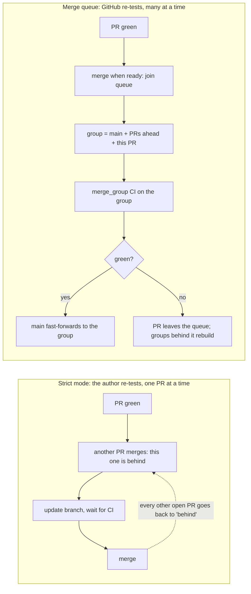

# merge-queue-lab

**GitHub merge queue vs "require branches to be up to date", tested on a live
repository, with dependency bots, signed commits and pull-request-shaped checks.**

Many teams protect `main` with *strict* required checks: a pull request may
merge only if it contains the latest `main`. That's safe, but it turns every
merge into a serial update, wait and merge loop. GitHub's **merge queue**
promises the same safety without the loop. This repository tests that promise,
especially in the places where real setups differ from the demo:

- **Bots.** A dependency bot (Renovate) merges its own PRs, and a workflow
  approves them. Other bots open PRs with `GITHUB_TOKEN`.
- **Signed commits on every branch.** The queue creates its own temporary
  branches. Does a "signatures required on `~ALL`" ruleset get in the way?
- **Pull-request-shaped checks.** A "changelog fragment" check reads the PR's
  base and head. Inside a merge queue there is no pull request.
- **Bypass and direct merges.** What admins, scripts and the REST API can still
  do on a branch that requires a queue.

Each scenario links to its pull requests and workflow runs, so you can check the
evidence rather than take it on trust.

> Status: the lab is being run. The results table fills in as scenarios finish.

## Results at a glance

| ID | Question | Result | Evidence |
| --- | --- | --- | --- |
| S0 | Without strict mode or a queue, can two green PRs break `main`? | _running_ | [scenarios.md#s0](docs/scenarios.md#s0) |
| S1 | Strict mode: what does landing 4 independent PRs cost? | _running_ | [scenarios.md#s1](docs/scenarios.md#s1) |
| S2 | Merge queue: the same 4 PRs | _running_ | [scenarios.md#s2](docs/scenarios.md#s2) |
| S3 | Does the queue catch a semantic conflict? | _running_ | [scenarios.md#s3](docs/scenarios.md#s3) |
| S4 | A required check whose workflow lacks `merge_group` | _running_ | [scenarios.md#s4](docs/scenarios.md#s4) |
| S5 | Signed commits required on every branch, plus a queue | _running_ | [scenarios.md#s5](docs/scenarios.md#s5) |
| S6 | A pull-request-shaped check inside a merge group | _running_ | [scenarios.md#s6](docs/scenarios.md#s6) |
| S7 | Direct merges and bypass on a queue branch | _running_ | [scenarios.md#s7](docs/scenarios.md#s7) |
| S8 | Strict mode *and* a queue together | _running_ | [scenarios.md#s8](docs/scenarios.md#s8) |
| S9 | The queue ruleset is deleted and recreated while PRs wait | _running_ | [scenarios.md#s9](docs/scenarios.md#s9) |
| B1 | Renovate: bot approval, platform auto-merge, queue | _running_ | [scenarios.md#b1](docs/scenarios.md#b1) |
| B2 | A PR opened with `GITHUB_TOKEN`: does CI run? | _running_ | [scenarios.md#b2](docs/scenarios.md#b2) |
| B3 | `GITHUB_TOKEN` turns on auto-merge: does it reach the queue? | _running_ | [scenarios.md#b3](docs/scenarios.md#b3) |
| B4 | `gh pr merge --auto --delete-branch` on a queue branch | _running_ | [scenarios.md#b4](docs/scenarios.md#b4) |
| B5 | A bot pushes an unsigned commit under "signatures on every branch" | _running_ | [scenarios.md#b5](docs/scenarios.md#b5) |

## How the two models differ



The concepts are explained step by step in [docs/concepts.md](docs/concepts.md),
which defines every term before using it.

## What's in the repository

| Path | Purpose |
| --- | --- |
| `src/mqlab/`, `tests/` | A tiny Python package: the code under test. `tests/integration` sleeps 90 s to stand in for a slow suite |
| `.github/workflows/ci.yml` | Lint, unit, simulated integration, and one aggregator check, **Required checks**. Triggers: `pull_request`, `merge_group`, `push` to `main` |
| `.github/workflows/changelog.yml` | A PR-shaped check in two variants: *naive* (breaks in a merge group) and *queue-safe* (skips itself there) |
| `.github/workflows/changelog-pr-only.yml` | The same check without a `merge_group` trigger (scenario S4) |
| `.github/workflows/bot-approve.yml` | Approves Renovate and Dependabot PRs as `github-actions[bot]` |
| `.github/workflows/bot-pr.yml` | Opens a PR as `github-actions[bot]` with `GITHUB_TOKEN`, for scenarios B2–B5 |
| `config/` | The protection models as JSON: classic protection, merge-queue ruleset, signed-commits ruleset, repo settings |
| `scripts/lab.py` | Applies a model, opens scenario PRs, lands them, probes merge paths, measures. REST-only via `gh` |
| `docs/` | [Concepts](docs/concepts.md), [scenarios](docs/scenarios.md), [bots](docs/bots.md), [settings](docs/settings.md), raw [results](docs/results/) |
| `renovate.json` | Renovate with `automerge: true` (platform auto-merge), like many real repos |

## Reproduce it

A merge queue needs a **public repository owned by an organization**, or a
private one on GitHub Enterprise Cloud.
([docs](https://docs.github.com/en/pull-requests/how-tos/merge-and-close-pull-requests/merging-a-pull-request-with-a-merge-queue))

1. Fork or copy this repository into an organization you own (a free
   organization works).
2. In the organization's Actions settings, allow GitHub Actions to create and
   approve pull requests. This is only needed for the bot-approval scenario.
3. Optional: install the Renovate GitHub App on the repository.
4. With an authenticated `gh` that has admin rights on the repository, run:

```bash
export MQLAB_REPO=<org>/merge-queue-lab
scripts/lab.py apply settings
scripts/lab.py apply signed-commits
scripts/lab.py apply classic                 # strict baseline
scripts/lab.py open lanes --n 4 --tag s1
scripts/lab.py land strict <the four PR numbers> --label s1-strict
scripts/lab.py collect <the four PR numbers> --label s1-strict
scripts/lab.py apply queue --timeout 10      # merge queue on main
scripts/lab.py open lanes --n 4 --tag s2
scripts/lab.py land queue <the four PR numbers> --label s2-queue
scripts/lab.py collect <the four PR numbers> --label s2-queue
```

Every scenario's exact commands are in [docs/scenarios.md](docs/scenarios.md).

## Trade-offs in one table

See [docs/scenarios.md](docs/scenarios.md) for the evidence behind each row.

| | Strict required checks | Merge queue |
| --- | --- | --- |
| Guarantee | `main` only receives combinations that were tested | Same |
| Who re-tests after `main` moves | The PR author, by updating the branch | GitHub, by building merge groups |
| Landing N green PRs | Serial: about N CI cycles plus N−1 updates | Parallel: about one CI cycle if all pass (up to the build-concurrency limit) |
| CI runs per PR | PR runs plus one rerun per update | PR run plus one group run (plus rebuilds after ejections) |
| Checks that read the PR | Work | Need `if: github.event_name == 'pull_request'` to skip themselves in groups |
| Bots using an App token (Renovate) | Work with auto-merge | Work: auto-merge enqueues |
| Bots using `GITHUB_TOKEN` | Their PR events start runs that need approval | Same, and they cannot add PRs to the queue |
| Configuration as code (Terraform) | `github_branch_protection` | `github_repository_ruleset` with `merge_queue` (provider ≥ 6.6.0) |

## Sources

GitHub documentation and changelog entries are linked inline in each doc. They
were read on 2026-10-20; GitHub.com is unversioned, so the date is the version.
Community reports are labelled as such and never treated as documentation.

## License

MIT. See [LICENSE](LICENSE).
