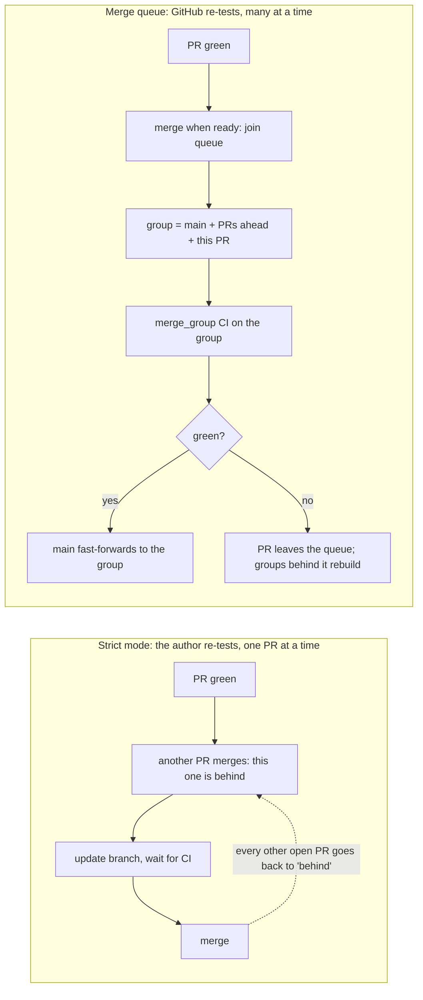

# merge-queue-lab

**GitHub merge queue vs "require branches to be up to date", tested on a live
repository, with dependency bots, signed commits and pull-request-shaped checks.**

Many teams protect `main` with *strict* required checks: a pull request may
merge only if it contains the latest `main`. That's safe, but it turns every
merge into a serial update, wait and merge loop. GitHub's **merge queue**
promises the same safety without the loop. This repository tests that promise,
especially in the places where real setups differ from the demo:

- **Bots.** A dependency bot (Renovate) merges its own PRs, and a workflow
  approves them. Other bots open PRs with `GITHUB_TOKEN`.
- **Signed commits on every branch.** The queue creates its own temporary
  branches. Does a "signatures required on `~ALL`" ruleset get in the way?
- **Pull-request-shaped checks.** A "changelog fragment" check reads the PR's
  base and head. Inside a merge queue there is no pull request.
- **Bypass and direct merges.** What admins, scripts and the REST API can still
  do on a branch that requires a queue.

Each scenario links to its pull requests and workflow runs, so you can check the
evidence rather than take it on trust.

> Status: every scenario below ran on 2026-10-21 against this repository. Each
> result links to its write-up in [docs/scenarios.md](docs/scenarios.md), which
> links to the pull requests and runs. Raw numbers are in [docs/results/](docs/results/).

## Results at a glance

| ID | Question | Result | Evidence |
| --- | --- | --- | --- |
| S0 | Without strict mode or a queue, can two green PRs break `main`? | Yes. `main` went red and stayed red for 7 minutes, until a fix-forward PR landed | [scenarios.md#s0](docs/scenarios.md#s0) |
| S1 | Strict mode: what does landing 4 independent PRs cost? | **7.6 min**, 7 CI runs, 3 "Update branch" round trips | [scenarios.md#s1](docs/scenarios.md#s1) |
| S2 | Merge queue: the same 4 PRs | **2.7 min**, 8 CI runs, no branch updates: 2.8× faster for one extra run | [scenarios.md#s2](docs/scenarios.md#s2) |
| S3 | Does the queue catch a semantic conflict? | Yes. The pair failed together in the queue; `main` stayed green | [scenarios.md#s3](docs/scenarios.md#s3) |
| S4 | A required check whose workflow lacks `merge_group` | The PR looks green, then is removed at the check timeout | [scenarios.md#s4](docs/scenarios.md#s4) |
| S5 | Signed commits required on every branch, plus a queue | No conflict. The tested group commit *is* the commit on `main`, signed by GitHub | [scenarios.md#s5](docs/scenarios.md#s5) |
| S6 | A pull-request-shaped check inside a merge group | The naive version fails in every group, so its PR is ejected in under a minute; a job-level skip passes | [scenarios.md#s6](docs/scenarios.md#s6) |
| S7 | Direct merges and bypass on a queue branch | REST merge: HTTP 405. Async `direct_merge` / `bypass_rules`: "pending", then nothing | [scenarios.md#s7](docs/scenarios.md#s7) |
| S8 | Strict mode *and* a queue together | Free: a PR behind `main` is queued and merged without an update | [scenarios.md#s8](docs/scenarios.md#s8) |
| S9 | The queue ruleset is deleted and recreated while PRs wait | Queued PRs are **stranded**: never merged or removed until enqueued again | [scenarios.md#s9](docs/scenarios.md#s9) |
| S10 | "Restrict who can push" on top of a queue | **Blocks every queue merge** (`branch_protection_failure`), even for an explicitly allowed enqueuer | [scenarios.md#s10](docs/scenarios.md#s10) |
| S11 | Enqueue through the async API before the PR's checks pass | The request is dropped silently; use auto-merge instead | [scenarios.md#s11](docs/scenarios.md#s11) |
| B1 | Renovate: bot approval, platform auto-merge, queue | Works. PRs that edit neighbouring lines eject each other; Renovate rebases and retries | [scenarios.md#b1](docs/scenarios.md#b1) |
| B2 | A PR opened with `GITHUB_TOKEN`: does CI run? | Only after someone approves the runs (UI or REST) | [scenarios.md#b2](docs/scenarios.md#b2) |
| B3 | Can a `GITHUB_TOKEN` bot get a PR through the queue? | No. Either it never enters, or it enters and its group gets no CI | [scenarios.md#b3](docs/scenarios.md#b3) |
| B4 | `gh pr merge --auto --delete-branch` on a queue branch | Refused by gh | [scenarios.md#b4](docs/scenarios.md#b4) |
| B5 | A bot pushes an unsigned commit under "signatures on every branch" | Rejected (GH013) | [scenarios.md#b5](docs/scenarios.md#b5) |

## What the documentation didn't tell us

1. **The queue tests the exact commit that lands.** Each group's head commit
   became `main`'s new commit, signed by GitHub, so a "signatures on every
   branch" ruleset never got in the way (S5). A test-only workflow on `push` to
   `main` then re-tests a commit the queue already tested.
2. **A `GITHUB_TOKEN` bot can't get a PR through the queue.** The docs say it
   can't enqueue. In fact `gh pr merge --auto` on a green PR *did* enqueue, but
   the bot-caused `merge_group` event started no CI, and the PR timed out (B3).
3. **The async merge API's answer means "request received", nothing more.** It
   answered `"status": "pending"` for direct merges it would never do, for a PR
   with a conflict, and for a PR whose checks hadn't finished. All of them were
   then silently dropped (S7, S11, B3).
4. **Recreating the queue's ruleset strands whatever is queued.** Configuration
   tools that delete and recreate rulesets on every apply leave PRs that are
   neither merged nor removed until someone enqueues them again (S9).
5. **Classic "Restrict who can push" and a queue don't mix.** Every queue merge
   failed with `branch_protection_failure` after its group passed, even when the
   enqueuer was explicitly allowed to push, and the merge-queue app can't be added
   to the allowance list (S10).
6. **Dependency PRs that edit neighbouring lines knock each other out.** When
   one merged, the other was removed "due to a conflict with the base branch";
   Renovate rebased it and the second attempt merged (B1).

## How the two models differ



The concepts are explained step by step in [docs/concepts.md](docs/concepts.md),
which defines every term before using it.

## What's in the repository

| Path | Purpose |
| --- | --- |
| `src/mqlab/`, `tests/` | A tiny Python package: the code under test. `tests/integration` sleeps 90 s to stand in for a slow suite |
| `.github/workflows/ci.yml` | Lint, unit, simulated integration, and one aggregator check, **Required checks**. Triggers: `pull_request`, `merge_group`, `push` to `main` |
| `.github/workflows/changelog.yml` | A PR-shaped check in two variants: *naive* (breaks in a merge group) and *queue-safe* (skips itself there) |
| `.github/workflows/changelog-pr-only.yml` | The same check without a `merge_group` trigger (scenario S4) |
| `.github/workflows/bot-approve.yml` | Approves Renovate and Dependabot PRs as `github-actions[bot]` |
| `.github/workflows/bot-pr.yml` | Opens a PR as `github-actions[bot]` with `GITHUB_TOKEN` (B2–B5) |
| `.github/workflows/bot-enqueue.yml` | Asks GitHub, as `github-actions[bot]`, to merge an existing PR (B3) |
| `.github/workflows/apply-config.yml` | Switches the protection model with the `LAB_ADMIN_TOKEN` secret |
| `.github/workflows/prepare-branches.yml` | Creates a scenario's branches with commits GitHub signs |
| `config/` | The protection models as JSON: classic protection, merge-queue ruleset, signed-commits ruleset, repo settings |
| `scripts/lab.py` | Applies a model, opens scenario PRs, lands them, probes merge paths, measures. REST-only via `gh` |
| `docs/` | [Concepts](docs/concepts.md), [scenarios](docs/scenarios.md), [bots](docs/bots.md), [settings](docs/settings.md), raw [results](docs/results/) |
| `renovate.json` | Renovate with `automerge: true` (platform auto-merge), like many real repos |

## Reproduce it

A merge queue needs a **public repository owned by an organization**, or a
private one on GitHub Enterprise Cloud.
([docs](https://docs.github.com/en/pull-requests/how-tos/merge-and-close-pull-requests/merging-a-pull-request-with-a-merge-queue))

1. Fork or copy this repository into an organization you own (a free
   organization works).
2. In the organization's and the repository's Actions settings, allow GitHub
   Actions to create and approve pull requests. Only B1 needs this.
3. Optional: install the Renovate GitHub App on the repository (B1).
4. Create a fine-grained token for this repository only, with **Administration:
   read and write** and a short expiry, and save it as the `LAB_ADMIN_TOKEN`
   repository secret. The `apply-config.yml` workflow uses it to switch
   protection models.
5. Drive a scenario. This is how the results here were produced:

```bash
export MQLAB_REPO=<org>/merge-queue-lab
gh workflow run apply-config.yml -f model=settings
gh workflow run apply-config.yml -f model=signed-commits
gh workflow run apply-config.yml -f model=queue -f approvals=0 -f timeout=10

# S2: branches and signed commits come from a workflow, the PRs from you
gh workflow run prepare-branches.yml -f kind=lanes -f n=4 -f tag=s2
scripts/lab.py open lanes --n 4 --tag s2 --phase prs      # prints the PR numbers
scripts/lab.py land queue <PRs> --label s2-queue           # wait until they are green first
scripts/lab.py collect <PRs> --label s2-queue

# S1: the strict baseline
gh workflow run apply-config.yml -f model=classic -f approvals=0
gh workflow run prepare-branches.yml -f kind=lanes -f n=4 -f tag=s1
scripts/lab.py open lanes --n 4 --tag s1 --phase prs
scripts/lab.py land strict <PRs> --label s1-strict
scripts/lab.py collect <PRs> --label s1-strict
```

`scripts/lab.py` talks to GitHub only through `gh api` (REST). If your `gh`
token has admin rights, `scripts/lab.py apply <model>` works locally too.
Every scenario's steps are in [docs/scenarios.md](docs/scenarios.md), and
[docs/settings.md](docs/settings.md) explains the workflows and the maintenance
windows used to change the lab itself.

## Trade-offs in one table

See [docs/scenarios.md](docs/scenarios.md) for the evidence behind each row.

| | Strict required checks | Merge queue |
| --- | --- | --- |
| Guarantee | `main` only receives combinations that were tested | Same, and the tested commit is the exact commit that lands (S5) |
| Who re-tests after `main` moves | The PR author, by updating the branch | GitHub, by building merge groups |
| Landing 4 green PRs (this lab) | 7.6 min, 3 branch updates (S1) | 2.7 min, no updates (S2) |
| CI runs for those 4 PRs | 7 (4 PR + 3 after updates) | 8 (4 PR + 4 group) |
| Checks that read the PR | Work | Need `if: github.event_name == 'pull_request'` to skip themselves in groups (S6) |
| A required check without a `merge_group` trigger | Works | Every PR is removed at the check timeout (S4) |
| Bots using an App token (Renovate) | Work with auto-merge | Work: auto-merge enqueues (B1) |
| Bots using `GITHUB_TOKEN` | Their PR runs need approval | Same, and they can't get a PR through the queue (B3) |
| Skipping the rules | Admins, unless `enforce_admins` | Only actors on the ruleset's bypass list (S7) |
| Configuration as code (Terraform) | `github_branch_protection` | `github_repository_ruleset` with `merge_queue` (provider ≥ 6.6.0); update it in place, because recreating it strands queued PRs (S9) |
| "Restrict who can push" (classic) | Works | Blocks every merge the queue tries (S10) |

## Sources

GitHub documentation and changelog entries are linked inline in each doc. They
were read on 2026-10-20 and the lab ran on 2026-10-21; GitHub.com is unversioned,
so the dates are the version.
Community reports are labelled as such and never treated as documentation.

## License

MIT. See [LICENSE](LICENSE).
