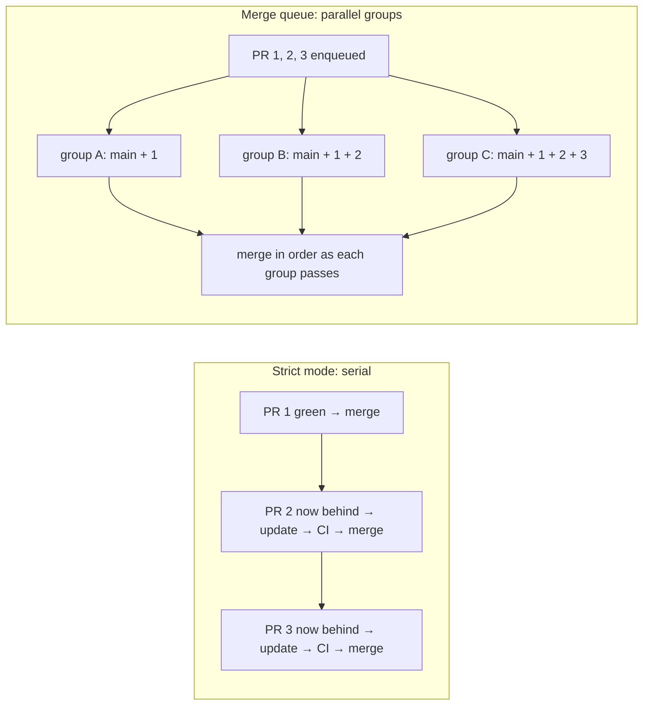

# Concepts: from protected branches to the merge queue

This page builds the idea in layers. Each layer defines its terms before using
them, explains the mechanism, and then states what that means in practice.
Later layers lean on earlier ones, so read top to bottom the first time.

Sources were read on 2026-10-20. GitHub.com is not versioned, so the date is
the version. Statements are tagged:

- **[Docs]**: GitHub (or tool) documentation says it, with a link.
- **[Lab]**: this repository observed it. See [scenarios.md](scenarios.md).
- **[Inference]**: a conclusion. The facts it rests on are named.

---

## Layer 1: protected branches and required checks

**Definitions**

- A **protected branch** is a branch with rules that GitHub enforces on every
  change, for example "changes only arrive through pull requests".
- A **required status check** is a named check (for example `Required checks`)
  that must report success on a pull request's latest commit before GitHub
  lets it merge.
- Rules come from two places:
  - **Classic branch protection**: one rule per branch pattern, and only one
    applies at a time.
  - **Rulesets**: named, stackable rule sets.

  All applicable rulesets *and* the classic rule are enforced together, and the
  most restrictive version of each rule wins.
  [Docs: about rulesets](https://docs.github.com/en/repositories/configuring-branches-and-merges-in-your-repository/managing-rulesets/about-rulesets)

**Mechanism.** When you open a pull request, GitHub builds a *test merge* of
your branch into the base and runs CI on it. A required check is satisfied by a
success on the **latest commit SHA** of the PR. Checks from earlier commits
don't count.
[Docs: troubleshooting required status checks](https://docs.github.com/en/pull-requests/how-tos/merge-and-close-pull-requests/troubleshooting-required-status-checks)

**In practice.** CI tells you that *your change on top of the base as it was
when CI ran* works. It says nothing about the base as it is at merge time.

## Layer 2: why "green" can still break main, and what strict mode does

**Definition.** A **semantic conflict** is two changes that merge without a
textual conflict, are each green alone, and are broken together.

Example from this lab: PR A renames `apply_discount`. PR B adds a new caller of
`apply_discount`. Git merges both cleanly, but the code no longer imports.
[Lab: S0, S3]

**Mechanism.** Layer 1 explains it. PR B's green check ran against a base that
didn't contain PR A yet. After A merges, B's result describes code that no
longer exists.

**Strict mode** ("Require branches to be up to date before merging",
`strict: true` in the API) closes that gap. A PR may only merge when it contains
the latest base commit. Every merge to `main` makes every other open PR
**behind**. Each one must be updated, re-tested and only then merged.
[Docs: about protected branches](https://docs.github.com/en/repositories/configuring-branches-and-merges-in-your-repository/managing-protected-branches/about-protected-branches)

**In practice.** Strict mode is safe but serial. To land N green PRs, someone
updates and waits N-1 times, and the waits are as long as your slowest required
check. [Lab: S1]

## Layer 3: the merge queue

**Definitions**

- A **merge queue** is a rule that sends merges through a queue instead of
  merging directly.
- When a PR enters the queue, GitHub creates a **merge group**: a commit
  containing the latest base, plus every PR ahead in the queue, plus this PR. It
  lives on a temporary, read-only branch whose name starts with
  `gh-readonly-queue/<base>/`.
- GitHub runs the required checks on that commit, then fast-forwards the base
  to it.
  [Docs: managing a merge queue](https://docs.github.com/en/repositories/configuring-branches-and-merges-in-your-repository/configuring-pull-request-merges/managing-a-merge-queue)

**Mechanism.**



- Groups build in parallel, up to the *build concurrency* limit (0–100; 0
  pauses the queue). [Docs: REST rulesets schema](https://docs.github.com/en/rest/repos/rules)
- If a group fails, the PR that broke it is removed. Every group behind it is
  destroyed and rebuilt without that PR. [Docs: managing a merge queue](https://docs.github.com/en/repositories/configuring-branches-and-merges-in-your-repository/configuring-pull-request-merges/managing-a-merge-queue)
- *Grouping strategy* decides what "a group passes" means:
  - `ALLGREEN` ("only merge non-failing pull requests"): each PR's commit in the
    group must pass.
  - `HEADGREEN`: only the group's head must pass. That tolerates a flaky middle
    entry.
- A required check that doesn't answer within the *status check timeout* (1–360
  minutes) is treated as failed.

**In practice.** You get strict mode's guarantee, because what merges is exactly
what was tested on top of current `main`. Nobody presses "Update branch", and N
PRs land in roughly one CI duration instead of N. In GitHub's words, the queue
"provides the same benefits as the Require branches to be up to date before
merging branch protection, but does not require a pull request author to update
their pull request branch".
[Docs: about protected branches](https://docs.github.com/en/repositories/configuring-branches-and-merges-in-your-repository/managing-protected-branches/about-protected-branches)
[Lab: S2, S3]

## Layer 4: the `merge_group` event and pull-request-shaped checks

**Definitions**

- `merge_group` is the GitHub Actions trigger that fires when the queue needs
  checks for a group (activity type `checks_requested`).
- In such a run:
  - `GITHUB_SHA` is the group's commit.
  - `GITHUB_REF` is the group's ref.
  - `github.event.merge_group.{base_sha, head_sha, head_ref}` describe the
    group.
  - **There is no `github.event.pull_request`.**

  [Docs: events that trigger workflows](https://docs.github.com/en/actions/reference/workflows-and-actions/events-that-trigger-workflows)

**Mechanism: three consequences.**

1. **A missing trigger stalls the queue.** If a workflow that produces a
   required check doesn't list `merge_group`, the check never reports for the
   group. The PR waits until the timeout and is removed. GitHub warns: "The
   merge will fail as the required status check will not be reported." [Docs,
   same page] [Lab: S4]
2. **One list of required checks gates both doors.** The same checks must pass
   on the PR before it can be queued, and on the group before it merges.
   GitHub's docs say the first half: "Once a pull request has passed all
   required branch protection checks, a user with write access … can add the
   pull request to the queue". Users report there is no way to require
   different checks for entry and for merge.
   [Docs: about protected branches](https://docs.github.com/en/repositories/configuring-branches-and-merges-in-your-repository/managing-protected-branches/about-protected-branches),
   [Community #61326](https://github.com/orgs/community/discussions/61326)
3. **Pull-request-shaped checks break.** A check that reads the PR (its
   base/head SHAs, labels, author type) sees empty values in a group:
   - `git diff "$BASE" "$HEAD"` with two empty strings fails.
   - `if: github.event.pull_request.user.type != 'Bot'` is *true* for
     everything, because `null != 'Bot'`.

   [Lab: S6]

**The fix pattern.** Gate the job, not the workflow:

```yaml
jobs:
  changelog:
    if: github.event_name == 'pull_request'
```

A job skipped by `if:` reports **success** and satisfies a required check. A
workflow skipped by path or branch *filters* leaves its checks **pending**,
which blocks.
[Docs: status checks](https://docs.github.com/en/pull-requests/reference/status-checks),
[Docs: workflow syntax](https://docs.github.com/en/actions/reference/workflows-and-actions/workflow-syntax)

Path filters are also reported not to work on `merge_group`.
[Community #45899](https://github.com/orgs/community/discussions/45899)

**In practice.** Before turning on a queue, list every required check. Prove that
each one is produced in `merge_group` runs and doesn't depend on PR context.

## Layer 5: bots, tokens and the queue

**Definitions**

- **`GITHUB_TOKEN`**: the per-run token a workflow gets.
- **App token**: a token for a GitHub App installation, which is how Renovate
  acts.
- **Auto-merge** ("Merge when ready"): "merge once requirements pass". On a
  branch with a queue it means "enqueue once requirements pass".
  [Docs: merging with a merge queue](https://docs.github.com/en/pull-requests/how-tos/merge-and-close-pull-requests/merging-a-pull-request-with-a-merge-queue)

**Mechanism.**

- **Events caused by `GITHUB_TOKEN` start no new workflow runs.** Exceptions:
  - dispatch events
  - (since 2026-06-11) pull request opened, synchronize and reopened, which
    start runs that **require approval**

  `merge_group` is not an exception.
  [Docs: GITHUB_TOKEN](https://docs.github.com/en/actions/concepts/security/github_token),
  [Changelog 2026-06-11](https://github.blog/changelog/2026-06-11-bot-created-pull-requests-can-run-workflows-if-approved/)
- **"The built-in `GITHUB_TOKEN` cannot add pull requests to the queue."** Use a
  personal access token or an App token.
  [Docs: automating Dependabot](https://docs.github.com/en/code-security/tutorials/secure-your-dependencies/automating-dependabot-with-github-actions)
  The lab found a sharper version. `gh pr merge --auto` with `GITHUB_TOKEN` *did*
  put an already-green PR into the queue. But the group's `merge_group` event was
  caused by `GITHUB_TOKEN`, so it started no workflow runs, and the PR was removed
  at the timeout. [Lab: B3]
- **Renovate uses its App token.** With `platformAutomerge` (the default), it
  turns on GitHub auto-merge, and GitHub enqueues the PR when requirements pass.
  [Docs: Renovate automerge](https://docs.renovatebot.com/key-concepts/automerge/#github-merge-queue)
- **Required reviews still apply before queueing.** A workflow can approve bot
  PRs as `github-actions[bot]` if the organization and repository allow GitHub
  Actions to approve pull requests.
  [Docs: Actions settings](https://docs.github.com/en/repositories/managing-your-repositorys-settings-and-features/enabling-features-for-your-repository/managing-github-actions-settings-for-a-repository)

**In practice.** Bots that act through an App token (Renovate) fit the queue.
Bots that act through `GITHUB_TOKEN` need a human, or a different token, to get
their PRs tested and queued. [Lab: B1–B4]

## Layer 6: signatures, bypass and direct merges

**Mechanism.**

- **Signatures:**
  - GitHub signs commits it creates through the web and API, and squash merges.
  - It cannot sign *rebase* merges.
  - Rulesets check signatures when a branch is created, but only for commits not
    reachable from another branch.
  - The docs don't say whether merge-group commits are signed, or whether a
    ruleset targeting `~ALL` branches applies to `gh-readonly-queue/*`. In the
    lab, a signatures ruleset on `~ALL` never got in the way. The group commit is
    created and signed by GitHub, and it is the very commit that lands on
    `main`. [Lab: S5]

  [Docs: merge methods](https://docs.github.com/en/repositories/configuring-branches-and-merges-in-your-repository/configuring-pull-request-merges/about-merge-methods-on-github),
  [Docs: available rules](https://docs.github.com/en/repositories/configuring-branches-and-merges-in-your-repository/managing-rulesets/available-rules-for-rulesets)
  [Lab: S5]
- **Direct merges:**
  - The classic REST merge endpoint "does not support … merging with a merge
    queue".
  - The async merge API (GA 2026-10-01) has
    `merge_action: default | direct_merge | merge_queue` and `bypass_rules`.
  - `gh pr merge --admin` bypasses a queue where allowed.
  - In the lab, the REST merge endpoint answered HTTP 405 "Changes must be made
    through the merge queue". The async API accepted `direct_merge`, with or
    without `bypass_rules`, answered `"status": "pending"`, and then did nothing,
    because the bypass list was empty. Its answer never tells you whether the
    merge will happen. [Lab: S7, S11]

  [Changelog 2026-10-01](https://github.blog/changelog/2026-10-01-github-async-merge-api-generally-available),
  [gh pr merge](https://cli.github.com/manual/gh_pr_merge)
  [Lab: S7]
- **Configuration as code.** The classic "Require merge queue" toggle has no
  REST or GraphQL field. In Terraform, a queue is only expressible in
  `github_repository_ruleset` (integrations/github ≥ v6.6.0), not in
  `github_branch_protection` or organization rulesets.
  [Release v6.6.0](https://github.com/integrations/terraform-provider-github/releases/tag/v6.6.0)
  Update that ruleset in place. Deleting and recreating it stranded the PRs that
  were in the queue: their groups passed, but they were never merged or removed
  until someone enqueued them again. [Lab: S9]

---

## Look-alikes, side by side

| Pair | One | The other |
| --- | --- | --- |
| Strict mode vs merge queue | The **author** updates and re-tests, one PR at a time | The **queue** builds the combination itself, many at a time |
| Auto-merge vs merge queue | *When* to merge (once requirements pass) | *How* to merge (via a tested group). With a queue, auto-merge enqueues |
| PR check vs group check | Tests the PR head merged into its base when CI ran | Tests base + PRs ahead + this PR, at merge time |
| Skipped job vs skipped workflow | Reports success; satisfies a required check | Leaves checks pending; blocks |
| App token vs `GITHUB_TOKEN` | Its events trigger workflows; can enqueue | Its events mostly don't trigger workflows; can't get a group tested, even when it manages to enqueue |

## Summary

Required checks prove a change works on the base *as it was*, so two green PRs
can still break `main`. Strict mode fixes that by making each author update and
re-test before merging. That's safe, but serial.

A merge queue keeps the same guarantee by testing each PR on top of current
`main` plus everything ahead of it in the queue. It builds those combinations in
parallel and merges only what passed.

The price is in the details:

- Every required check must run on `merge_group` and must not depend on
  pull-request context.
- Bots must act through tokens that are allowed to trigger workflows and enqueue.
- Signing, bypass and configuration-as-code each need checking against the
  queue's temporary branches and API surface. In this lab, signing was fine,
  bypass needed an explicit list, and recreating the ruleset stranded queued PRs.

The scenarios in this repository test each of those details on a live
repository.
